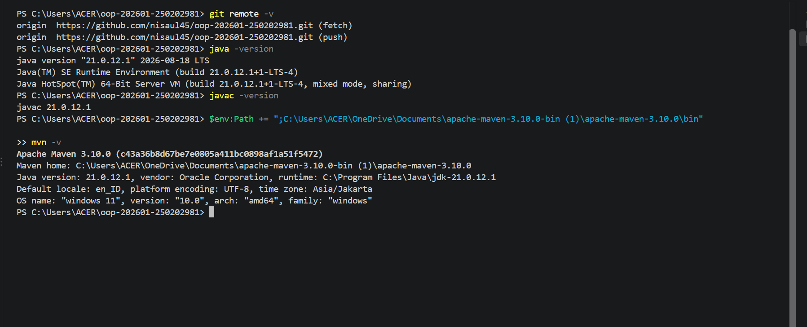
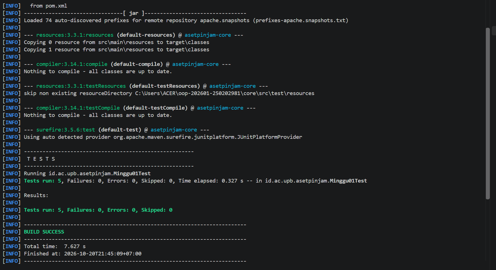

# Catatan Minggu 01: Paradigma Pemograman dan Setup

## Yang saya kerjakan
Saya mempelajari perbedaan tiga paradigma diantaranya ada prosedural, OOP, dan fungsional melalui pembuatan program Aset-Pinjam. Selain itu, saya mengisi data mahasiswa dan melengkapi file, yaitu 'HelloFungsional.java', 'HelloOOP.java', 'HelloProsedural.java', serta menjalankan pengujian menggunakan script yang disediakan untuk memastikan program sesuai dengan ketentuan.

## Keputusan desain
Saya menggunakan kalimat sapaan sederhana agar mudah dipahami dan memastikan hasil ketiga paradigma memuat nama mahasiswa, nim, dan teks Aset-Pinjam. Paradigma prosedural menggunakan fungsi statis, OOP menggunakan field private, sedangkan fungsional menggunakan lambda. Ketiganya memiliki cara berbeda, tetapi menghasilkan teks yang sama.

## Kendala
Kendala yang saya alami yaitu memahamu struktur folder repository dan menentukan file mana yang harus dikerjakan. Selain itu, saya juga ada kendala dibagian file maven yang saat di jalankan diterminal file tidak ditemukan. Saya mengatasinya dengan memeriksa instruktur tugas dan mencari file yang harus dilengkapi.

## Penggunaan AI
- Alat yang dipakai: ChatGPT dan claude ai
- Bagian yang dibantu AI: Memahami perbedaan paradigma pemograman dan mengenal file yang perlu dikerjakan
- Prompt utama: Jelaskan cara instal maven, jelaskan perbedaan ketiga paradigma, mana saja file yang perlu diubah dan dibuat.
- Yang saya ubah atau tolak dari saran AI, dan alasannya: Tidak ada.
- Satu hal yang saya pahami lebih baik sekarang: Saya lebih memahami perbedaan ketiga paradigma pemrograman 
